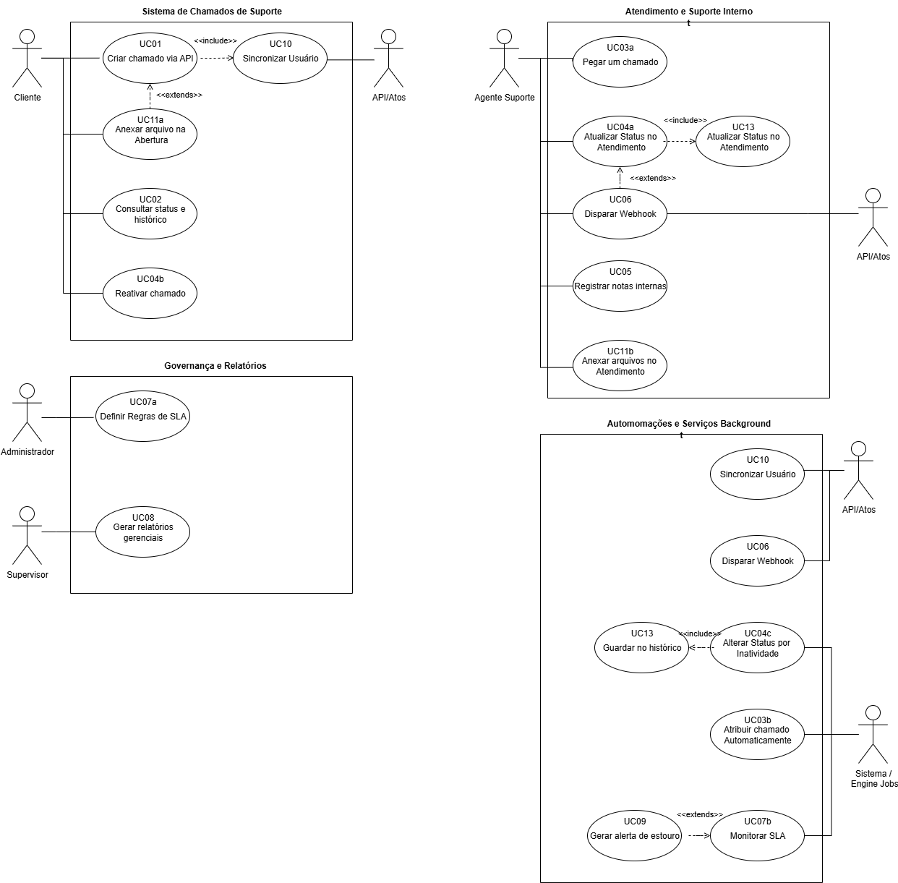

# 02 — Requisitos do Sistema

## 3.1 Requisitos Funcionais (RF01–RF13)

Essenciais RF01–RF10, Desejáveis RF11–RF13. Detalhados em UC01–UC11b/UC13 e Figura 1.

| Código | Requisito | Descrição | Ator primário | Mapeamento | Prioridade |
|---|---|---|---|---|---|
| RF01 | Criar chamado via API | Endpoint portal + SSO/JWT, retorna ID público, exige produto/módulo, categoria, descrição. Anexo opcional. | Cliente | UC01 + include UC10, extend UC11a | Essencial |
| RF02 | Consultar status e histórico | Status + histórico público via portal. | Cliente | UC02 | Essencial |
| RF03 | Atribuir chamado | Fila manual + automática por categoria. | Agente/Supervisor (manual), Sistema/Engine (auto) | UC03a, UC03b | Essencial |
| RF04 | Alterar status | aberto, em andamento, aguardando cliente, resolvido, fechado. Dinâmicas por executor. | Agente / Cliente / Sistema(job) | UC04a, UC04b, UC04c | Essencial |
| RF05 | Notas internas | Só equipe, nunca cliente. | Agente (Supervisor herda) | UC05 | Essencial |
| RF06 | Webhook eventos | criado, atualizado, aguardando cliente, fechado → Portal. Sistema-para-sistema. | Sistema | UC06 (extend dos UCs de estado) | Essencial |
| RF07 | Definir e monitorar SLA | Config por prioridade/categoria + contagem automática resposta/resolução. | Admin (config), Sistema (monitor) | UC07a, UC07b | Essencial |
| RF08 | Relatórios gerenciais | Filtráveis por produto, cliente/grupo, categoria, período + recorrência. | Supervisor (Admin herda) | UC08 | Essencial |
| RF09 | Alertas estouro SLA | Próximo/estourado → agente + supervisor. | Sistema (Job/n8n) | UC09 (extend UC07b) | Essencial |
| RF10 | Sincronizar usuário e grupo | Upsert via SSO/JWT. | Portal | UC10 (include UC01) | Essencial |
| RF11 | Anexar arquivos | Na abertura (cliente) e no atendimento (agente). | Cliente / Agente | UC11a, UC11b | Desejável |
| RF12 | Controle por papel | Regra transversal, pré-condição de todos UCs, sem oval própria. | — | transversal | Desejável |
| RF13 | Auditoria | Quem, quando, o quê (include em todo UC que modifica). | Sistema | UC13 | Desejável |

### Atores (resumo 2 linhas)

- **Cliente:** abre via Portal, acompanha status/histórico, responde/reativa.
- **API/Portal:** autentica SSO/JWT, fornece sincronização, recebe webhooks.
- **Agente:** pega chamados, status, notas, anexos.
- **Supervisor:** gestão, relatórios, SLA.
- **Administrador:** governança, regras/prazos SLA.
- **Sistema/Engine Jobs:** atribuição auto, SLA, inatividade.

### Especificação UCs (padrão RUP)

**UC01 Criar via API (RF01):** pré JWT válido + tabelas disponíveis. Fluxo: preenche → Portal→API + JWT/grupo → UC10 → valida → cria Aberto + ID público → UC13 → UC06 → retorna ID. Exceções: 401 JWT, 422 campos, erro UC10, extensão UC11a.

**UC02 Consultar (RF02):** lista por ID ou meus chamados, valida RF12, retorna status/SLA/públicos ordenados. 404/403. Nunca mostra UC05.

**UC03a Manual (RF03):** fila não atribuídos → destino → valida → vincula → Em Atendimento → UC13. Reatribuição exige confirmação.

**UC03b Automático (RF03):** engine por categoria/produto (round-robin/especialidade/carga). Sem regra → fila geral + avisa Supervisor.

**UC04a Atualizar status (RF04):** agente avança ciclo + comentário opcional. Valida transição, timestamp, UC13, UC06. Transição inválida bloqueia. Aguardando Cliente inicia contagem UC04c.

**UC04b Responder/Reativar (RF04):** cliente em Aguardando/Resolvido responde → volta Em Andamento/Aberto. Fechado bloqueia (abrir novo UC01).

**UC04c Inatividade (RF04):** job fecha Aguardando sem resposta após N dias → Fechado + UC13 + UC06.

**UC05 Notas internas (RF05):** flag interno=true, só painel interno, nunca UC06/UC02.

**UC06 Webhook (RF06):** payload ID/status/data/ator, POST com retry, log. Falha → retry/backoff. Sem notas internas.

**UC07a Definir SLA (RF07):** admin define resposta/resolução por prioridade/categoria + calendário. Valida conflitos.

**UC07b Monitorar SLA (RF07):** job calcula decorrido vs prazo (no prazo/em risco/estourado). Extend UC09.

**UC08 Relatórios (RF08):** filtros + agregação + export CSV/PDF. Só leitura.

**UC09 Alertas (RF09):** risco/estouro → agente + supervisor (e-mail/painel/n8n). Throttling anti-spam. Não notifica cliente.

**UC10 Sincronizar (RF10):** evento SSO → busca ID externo/e-mail → upsert + vincula grupo. Include UC01.

**UC11a Anexo abertura (RF11):** valida extensão/tamanho/vírus. Falha não bloqueia chamado.

**UC11b Anexo atendimento (RF11):** público ou interno, respeita RF12, se público dispara UC06.

> Figura 1 — Diagrama de Casos de Uso em 4 pacotes: Chamados, Atendimento Interno, Governança/Relatórios, Automações/Background.
>
> 

## 3.2 Requisitos Não-Funcionais

Base Sommerville 6ª ed. + Termo de Referência jul/2026.

| Categoria | Subcategoria | Requisito |
|---|---|---|
| Produto | Portabilidade/Arquitetura | Desacoplada do portal, reutilizável (ex.: Joe SFA B1) |
| Produto | Confiabilidade | Testes automatizados de SLA + ciclo de vida |
| Organizacional | Padrões/Interop | OpenAPI/Swagger |
| Organizacional | Implementação/Doc | ADRs junto ao código |
| Externo | Legais/Privacidade/Segurança | Logs de auditoria para compliance/SLA |

Stack: C#/.NET + React + PostgreSQL + n8n.

## 3.3 Protótipo

Mínimo: novo chamado; acompanhamento (lista/filtro/ID público); detalhe/timeline pública; fila (não atribuídos/meus/por SLA); detalhe agente (dados/SLA/completo/notas); resposta pública vs nota interna; status/atribuição manual+auto; SLA (no prazo/em risco/estourado); relatórios (filtros + recorrência); admin (papéis/categorias/prioridades/SLA).

Cada tela final: objetivo, origem/destinos, usuários, campos obrigatórios, validações, RN01–RN18. `[ESPAÇO RESERVADO PROTÓTIPOS]`

### 3.3.1 Navegação

Cliente: portal → novo → acompanhamento → detalhe/interação. Suporte: login interno → fila → detalhe → resposta/nota → status/atribuição → relatórios/config. `[ESPAÇO RESERVADO DIAGRAMA NAVEGAÇÃO]`

## 3.4 Métricas e Cronograma (Kanban)

- Semanas 1–2: kickoff/levantamento (Cap.1–3).
- Semanas 3–4: modelagem dados/arquitetura (Cap.4).
- Semanas 5–10: núcleo RF01–RF10 + telas.
- Semanas 11–12: testes/correções (Cap.5–6).
- Semanas 13–14: doc final, piloto, apresentação (Cap.7–9).

`[ESPAÇO RESERVADO CRONOGRAMA DETALHADO + UCP/FP]`
