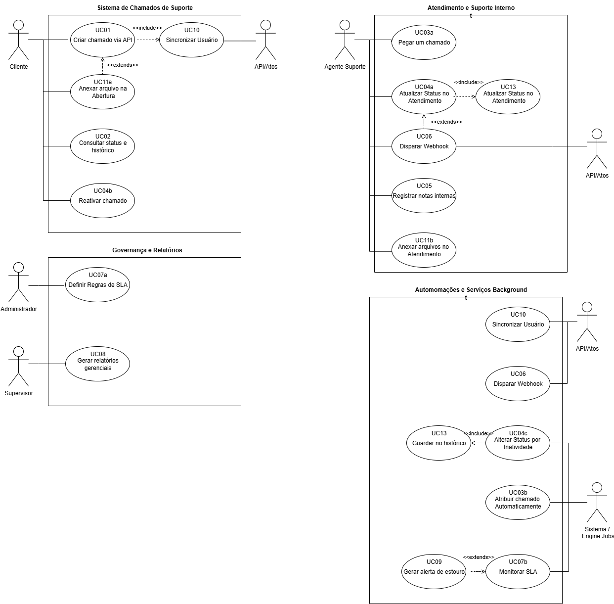

# 02B — Casos de Uso Detalhados (UC01–UC11b + UC13)

> 
> Regra transversal: RF12 (papel) é pré-condição de todos. RN18 fora do MVP.

## Atores

- **Cliente:** abre via Portal, acompanha status/histórico, responde/reativa.
- **API/Portal:** autentica SSO/JWT, sincroniza, recebe webhooks.
- **Agente:** fila, status, notas, anexos.
- **Supervisor:** gestão, relatórios, SLA.
- **Administrador:** regras/prazos SLA.
- **Sistema/Engine Jobs:** auto-atribuição, SLA, inatividade.

## UC01 — Criar Chamado via API | RF01 Essencial

| Item | Descrição |
|---|---|
| Nome | UC01 – Criar Chamado via API |
| Breve | Cliente cria pelo Portal, recebe ID público. Exige produto/módulo, categoria, descrição. |
| Atores | Primário: Cliente. Secundário: Portal (SSO/JWT) |
| Pré | 1. JWT válido. 2. Tabelas produto/categoria disponíveis. |
| Fluxo | 1. Preenche produto/módulo, categoria, descrição. 2. Portal→API com JWT+grupo. 3. Executa UC10. 4. Valida obrigatórios. 5. Cria Aberto + ID público. 6. Auditoria UC13. 7. Webhook UC06 criado. 8. Retorna ID. |
| Pós | Aberto, vinculado usuário+grupo, na fila. |
| Exceções | E1 JWT inválido 401. E2 faltantes 422. E3 falha UC10 aborta. A1 com anexo → UC11a. |
| Obs | include UC10, UC13. extend UC11a, UC06. Anexo opcional. |

## UC02 — Consultar Status e Histórico | RF02 Essencial

| Item | Descrição |
|---|---|
| Breve | Cliente consulta status + histórico público. |
| Atores | Cliente |
| Pré | 1. Autenticado. 2. Chamado seu/grupo. |
| Fluxo | 1. Informa ID/lista. 2. Valida RF12. 3. Retorna status, SLA, públicas + anexos públicos ordenados. |
| Pós | Sem alteração. Log acesso. |
| Exceções | E1 inexistente 404. E2 outro grupo 403. E3 portal fora. |
| Obs | Só leitura. UC05 nunca exibido. |

## UC03a — Atribuir Manualmente | RF03 Essencial

| Item | Descrição |
|---|---|
| Breve | Agente/Supervisor assume/repassa. |
| Atores | Agente / Supervisor |
| Pré | 1. Interno autenticado. 2. Aberto/não atribuído. |
| Fluxo | 1. Lista fila. 2. Seleciona chamado+destino. 3. Valida destino. 4. Vincula, vai Em Atendimento se configurado. 5. UC13. |
| Pós | Responsável definido, na caixa do agente. |
| Exceções | E1 já atribuído exige confirmação. E2 destino inativo bloqueia. |
| Obs | Pode disparar UC06 atualizado. |

## UC03b — Atribuir Automático por Categoria | RF03 Essencial

| Item | Descrição |
|---|---|
| Breve | Engine distribui por categoria/produto. |
| Atores | Sistema (Engine Fila) |
| Pré | 1. Sem responsável. 2. Regras cadastradas. |
| Fluxo | 1. Criação dispara. 2. Identifica categoria/produto. 3. Busca regra (round-robin/especialidade/carga). 4. Atribui. 5. UC13. |
| Pós | Atribuído, pronto. |
| Exceções | E1 sem regra → fila geral + avisa Supervisor. E2 sem agente → pendente + reagenda. |
| Obs | Sem humano. |

## UC04a — Atualizar Status | RF04 Essencial

| Item | Descrição |
|---|---|
| Breve | Agente avança: aberto, em andamento, aguardando cliente, resolvido, fechado. |
| Atores | Agente |
| Pré | 1. Autorizado. 2. Na sua fila/atribuído. |
| Fluxo | 1. Seleciona + comentário opcional. 2. Valida transição. 3. Atualiza + timestamp. 4. UC13. 5. UC06. |
| Pós | Novo estado, notificável. |
| Exceções | E1 inválida (fechado→aberto) bloqueia. E2 fechar sem resolução exige motivo. |
| Obs | Include UC13, extend UC06. Aguardando inicia UC04c. |

## UC04b — Responder e Reativar | RF04 Essencial

| Item | Descrição |
|---|---|
| Breve | Cliente responde Aguardando/Resolvido, reabre. |
| Atores | Cliente |
| Pré | 1. Dono autenticado. 2. Em Aguardando/Resolvido. |
| Fluxo | 1. Vê UC02 + responde. 2. Valida. 3. Adiciona pública, volta Em Andamento/Aberto. 4. Auditoria. 5. UC06 atualizado. |
| Pós | Reativado à fila. Pausa/retoma SLA. |
| Exceções | E1 Fechado bloqueia, orienta novo UC01. E2 vazia 422. |
| Obs | Pode incluir UC11a. |

## UC04c — Encerrar por Inatividade | RF04 Essencial

| Item | Descrição |
|---|---|
| Breve | Job fecha Aguardando sem resposta após prazo. |
| Atores | Sistema (Job) |
| Pré | 1. Aguardando há N dias. 2. Job ativo. |
| Fluxo | 1. Varre aguardando. 2. Filtra > limite. 3. Fecha motivo inatividade. 4. Auditoria. 5. UC06 fechado. |
| Pós | Fechado, SLA finalizado. |
| Exceções | E1 respondeu durante execução ignora (concorrência). |
| Obs | Extend UC06. |

## UC05 — Notas Internas | RF05 Essencial

| Item | Descrição |
|---|---|
| Breve | Anotações só equipe, nunca cliente. |
| Atores | Agente (Supervisor herda) |
| Pré | 1. Interno. 2. Chamado existe. |
| Fluxo | 1. Escreve nota. 2. Flag interno=true. 3. Só painel interno. 4. Auditoria. |
| Pós | Vinculada, oculta Portal/UC02. |
| Exceções | E1 tornar pública exige novo comentário. E2 vazia bloqueia. |
| Obs | Nunca UC06. UC02 filtra. |

## UC06 — Webhook Eventos | RF06 Essencial

| Item | Descrição |
|---|---|
| Breve | Sistema→Sistema notifica Portal (criado, atualizado, aguardando, fechado). |
| Atores | Primário: Sistema. Secundário: Portal recebe payload. |
| Pré | 1. Mudança ocorrida. 2. URL configurada. |
| Fluxo | 1. Evento (UC01, UC04a/b/c). 2. Monta payload ID/status/data/ator. 3. POST com retry. 4. Log entrega. |
| Pós | Portal atualizado, sucesso/falha registrada. |
| Exceções | E1 fora do ar retry/backoff + alerta. E2 assinatura registra segurança. |
| Obs | Extend dos UCs estado. Sem internas. |

## UC07a — Definir SLA | RF07 Essencial

| Item | Descrição |
|---|---|
| Breve | Admin configura 1ª resposta + resolução por prioridade/categoria. |
| Atores | Administrador |
| Pré | 1. Autenticado. 2. Categorias/prioridades cadastradas. |
| Fluxo | 1. Tela SLA. 2. Define tempos + calendário. 3. Valida conflitos. 4. Ativa versão. 5. Auditoria. |
| Pós | Vigentes dali em diante. |
| Exceções | E1 zero/negativo bloqueia. E2 sobreposição exige desempate. |
| Obs | Humana do RF07. |

## UC07b — Monitorar SLA | RF07 Essencial

| Item | Descrição |
|---|---|
| Breve | Job conta resposta/resolução real-time. |
| Atores | Sistema (Job) |
| Pré | 1. UC07a ativas. 2. Abertos/em andamento. |
| Fluxo | 1. Calcula decorrido vs prazo. 2. Atualiza (no prazo/em risco/estourado). 3. Painel. 4. Se risco → UC09. |
| Pós | Indicadores base alertas/relatórios. |
| Exceções | E1 regra mudou recalcula pro-rata. E2 Aguardando congela se parametrizado. |
| Obs | Extend UC09. |

## UC08 — Relatórios Gerenciais | RF08 Essencial

| Item | Descrição |
|---|---|
| Breve | Painel + recorrentes com filtros produto/empresa/categoria/período. |
| Atores | Supervisor (Admin herda) |
| Pré | 1. Autenticado. 2. Base com dados. |
| Fluxo | 1. Filtros+período. 2. Agrega volume/SLA/recorrência. 3. Exibe/exporta CSV/PDF. |
| Pós | Visualizado, sem alterar. |
| Exceções | E1 vazio msg vazia. E2 excessivo pagina/refina. |
| Obs | Usa UC07b + auditoria. |

## UC09 — Alertas Estouro SLA | RF09 Essencial

| Item | Descrição |
|---|---|
| Breve | Risco/estouro → equipe recebe. |
| Atores | Primário: Sistema (Job/n8n). Secundário: Agente/Supervisor. |
| Pré | UC07b detectou + canal configurado. |
| Fluxo | 1. Identifica. 2. Monta ID/prazo/responsável/severidade. 3. Envia (e-mail/painel/n8n). 4. Registra anti-duplicar. |
| Pós | Notificada, crítico. |
| Exceções | E1 canal falha tenta alternativo. E2 já enviado throttling. |
| Obs | Extend UC07b. Não cliente. |

## UC10 — Sincronizar Usuário/Grupo | RF10 Essencial

| Item | Descrição |
|---|---|
| Breve | Upsert via SSO/JWT. |
| Atores | Primário: Portal. Secundário: API Suporte. |
| Pré | Evento SSO com id/e-mail/grupo. |
| Fluxo | 1. Portal envia login. 2. Busca ID externo/e-mail. 3. Cria/atualiza. 4. Vincula grupo. 5. Retorna IDs. |
| Pós | Aptos a vincular chamados. |
| Exceções | E1 sem grupo cria avulso + pendência. E2 e-mail outra empresa mescla/bloqueia. |
| Obs | Include pelo UC01. Multi matriz/filial. |

## UC11a — Anexar na Abertura | RF11 Desejável

| Item | Descrição |
|---|---|
| Breve | Cliente inclui prints/docs na criação. |
| Atores | Cliente |
| Pré | 1. UC01 executando. 2. Tipo/tamanho permitidos. |
| Fluxo | 1. Seleciona. 2. Valida ext/tamanho/vírus. 3. Armazena+vincula. 4. Auditoria. |
| Pós | Públicos vinculados. |
| Exceções | E1 inválido rejeita mantém criação. E2 falha conclui + pendência. |
| Obs | Extend UC01. Não bloqueia. |

## UC11b — Anexar no Atendimento | RF11 Desejável

| Item | Descrição |
|---|---|
| Breve | Agente inclui evidências/soluções. |
| Atores | Agente |
| Pré | 1. Autenticado. 2. Chamado acessível. |
| Fluxo | 1. Seleciona na thread. 2. Define público/interno. 3. Valida+armazena. 4. Se público UC06. 5. Auditoria. |
| Pós | Visibilidade definida. |
| Exceções | E1 inválido rejeita. E2 sem permissão RF12. |
| Obs | Extensão UC04a/UC05. |

## UC13 — Auditoria | Desejável (transversal)

Serviço interno auto, include em todo UC que modifica. Registra quem, quando, campo, anterior/novo. Sem oval própria, mas gera trilha para relatórios/compliance.
