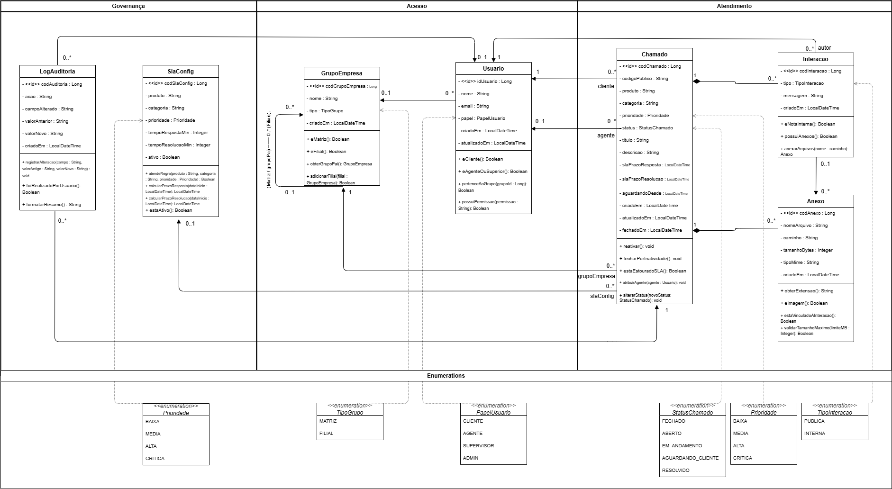
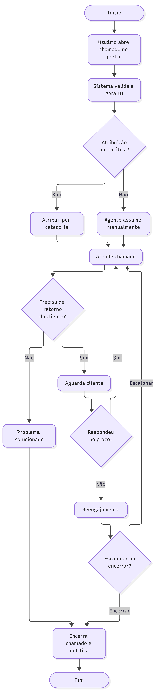
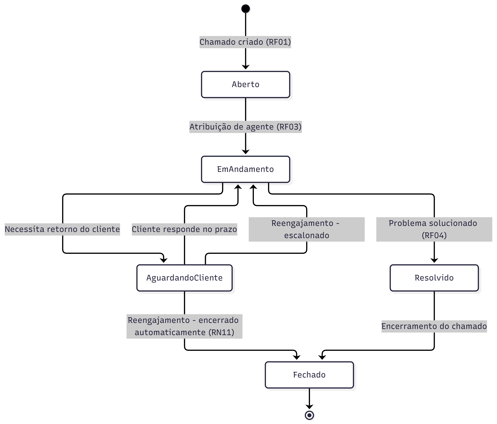

# 03 — Análise, Design e Dados

## 4.1 Arquitetura do Sistema

Desacoplada: React (web) → API C#/.NET → PostgreSQL + webhooks/n8n → Portal.

Fluxo: Portal Atos Capital → API Chamados → PostgreSQL → webhooks → Portal. Portal inicia com JWT; API valida, upsert usuário/grupo, serve abertura/acompanhamento. React consome API. n8n orquestra webhooks/alertas e futuras integrações (e-mail, WhatsApp). Expansível sem reconstruir núcleo.

`[ESPAÇO RESERVADO DIAGRAMA ARQUITETURA]`

## 4.2 Modelo do Domínio

- **Usuario** (id, nome, email, papel, grupoEmpresa, criadoEm/atualizadoEm): `eCliente()`, `eAgenteOuSuperior()`, `pertenceAoGrupo()`, `possuiPermissao()`.
- **GrupoEmpresa** (cod, nome, tipo MATRIZ/FILIAL, criadoEm): auto `grupoPai/filiais`; `eMatriz()`, `eFilial()`, `obterGrupoPai()`, `adicionarFilial()`.
- **Chamado** (cod, codigoPublico, produto, categoria, prioridade, status, título, descrição, slaPrazos, aguardandoDesde, datas): `reativar()`, `fecharPorInatividade()`, `estaEstouradoSLA()`, `atribuirAgente()`, `alterarStatus()`.
- **Interacao** (cod, tipo PUBLICA/INTERNA, mensagem, criadoEm): `eNotaInterna()`, `possuiAnexos()`, `anexarArquivos()`.
- **Anexo** (cod, nome, caminho, tamanhoBytes, tipoMime, criadoEm): valida extensão/tamanho/vínculo.
- **SlaConfig** (cod, produto, categoria, prioridade, tempoRespostaMin/ResolucaoMin, ativo): `atendeRegra()`, `calcularPrazo*()`, `estaAtivo()`.
- **LogAuditoria** (cod, acao, campo, anterior/novo, criadoEm): `registrarAlteracao()`, etc.

## 4.3 Interação / Sequência

Priorizados: abertura (UC01+UC10), sincronização (UC10), status (UC04a), reativação (UC04b), inatividade (UC04c), pública/interna (UC05), webhook (UC06), SLA (UC07b/UC09).

Sequência abertura/atendimento: Cliente → Portal (JWT+grupo) → API (valida JWT, UC10 upsert, valida, cria Aberto+codigoPublico, UC13, UC06) → retorna ID. Agente assume (UC03a/b), status (UC04a+UC13+UC06), notas (UC05), job SLA (UC07b→UC09).

`[ESPAÇO RESERVADO DIAGRAMA SEQUÊNCIA]`

## 4.4 Diagrama de Classes (Figura 2)

Pacotes Governança, Acesso, Atendimento, Enumerações. Conforme modelo lógico §4.8 + scripts versionados.

Leitura: Cliente (Usuario 0..*) abre Chamados; Agente (0..1) atende; Chamado 1—0..* Interacao; Chamado/Interacao 1—0..* Anexo; Usuario 0..*—0..1 GrupoEmpresa (matriz/filial); Chamado 0..*—1 SlaConfig; Chamado 1—0..* LogAuditoria. Enums: Prioridade (BAIXA/MEDIA/ALTA/CRITICA), TipoGrupo (MATRIZ/FILIAL), PapelUsuario (CLIENTE/AGENTE/SUPERVISOR/ADMIN), StatusChamado (FECHADO/ABERTO/EM_ANDAMENTO/AGUARDANDO_CLIENTE/RESOLVIDO), TipoInteracao (PUBLICA/INTERNA).

Figura 2 – Diagrama de Classes da Plataforma de Suporte (pacotes Governança, Acesso, Atendimento e Enumerações).

> 

## 4.5 Atividades

Fluxo abertura→fechamento com decisões manual/auto, espera cliente, resolução, encerramento normal/inatividade + UC13, UC06, UC07b/UC09.

> 

## 4.6 Estados

`ABERTO → EM_ANDAMENTO → AGUARDANDO_CLIENTE → RESOLVIDO → FECHADO`. Transições: atribuir (UC03a/b), responder (UC04a/b), solicitar cliente, reativar, inatividade (UC04c).

> 

## 4.6 (bis) Componentes

Mínimo: Portal, React, API .NET, PostgreSQL, JWT, webhooks, n8n. Dependências: React→API (HTTPS/JSON Swagger); API→PostgreSQL; API→Portal (webhooks); n8n→API/canais. `[ESPAÇO RESERVADO]`

## 4.7 Modelo de Dados

### 4.7.1 Lógico

Deriva de Figura 2 + TR: Usuario, GrupoEmpresa (grupo_pai), Chamado (usuario_id, grupo_empresa_id, agente_id, sla_config_id, codigo_publico único, status, prioridade, prazos), Interacao (chamado_id, autor_id, tipo), Anexo (chamado_id, interacao_id opcional), LogAuditoria (chamado_id, usuario_id, ação, campo/valores), SlaConfig única (produto, categoria, prioridade).

### 4.7.2 Físico (PostgreSQL + .NET migrations)

Scripts 1–6 já gerados. BIGSERIAL PK, FKs, UNIQUE, índices, defaults.

```sql
-- Script 1 — grupo_empresa
CREATE TABLE public.grupo_empresa (
  id BIGSERIAL NOT NULL,
  nome VARCHAR(150) NOT NULL,
  tipo VARCHAR(20) DEFAULT 'matriz',
  grupo_pai_id BIGINT DEFAULT NULL,
  criado_em TIMESTAMP DEFAULT CURRENT_TIMESTAMP,
  PRIMARY KEY (id),
  CONSTRAINT grupo_empresa_ibfk_1 FOREIGN KEY (grupo_pai_id)
    REFERENCES public.grupo_empresa (id)
);

-- Script 2 — usuario
CREATE TABLE public.usuario (
  id BIGSERIAL NOT NULL,
  nome VARCHAR(150) NOT NULL,
  email VARCHAR(255) NOT NULL,
  grupo_empresa_id BIGINT NOT NULL,
  papel VARCHAR(20) NOT NULL DEFAULT 'cliente',
  criado_em TIMESTAMP DEFAULT CURRENT_TIMESTAMP,
  atualizado_em TIMESTAMP DEFAULT NULL,
  PRIMARY KEY (id),
  CONSTRAINT email UNIQUE (email),
  CONSTRAINT usuario_ibfk_1 FOREIGN KEY (grupo_empresa_id)
    REFERENCES public.grupo_empresa (id)
);

-- Script 3 — sla_config
CREATE TABLE public.sla_config (
  id BIGSERIAL NOT NULL,
  produto VARCHAR(100) NOT NULL,
  categoria VARCHAR(100) NOT NULL,
  prioridade VARCHAR(20) NOT NULL,
  tempo_resposta_min INTEGER NOT NULL,
  tempo_resolucao_min INTEGER NOT NULL,
  ativo BOOLEAN DEFAULT TRUE,
  PRIMARY KEY (id),
  CONSTRAINT uq_sla_prod_cat_prio UNIQUE (produto, categoria, prioridade)
);

-- Script 3b — chamado
CREATE TABLE public.chamado (
  id BIGSERIAL NOT NULL,
  codigo_publico VARCHAR(20) NOT NULL,
  usuario_id BIGINT NOT NULL,
  grupo_empresa_id BIGINT NOT NULL,
  agente_id BIGINT DEFAULT NULL,
  sla_config_id BIGINT DEFAULT NULL,
  produto VARCHAR(100) NOT NULL,
  categoria VARCHAR(100) NOT NULL,
  prioridade VARCHAR(20) NOT NULL,
  status VARCHAR(30) NOT NULL DEFAULT 'aberto',
  titulo VARCHAR(200) NOT NULL,
  descricao TEXT NOT NULL,
  sla_prazo_resposta TIMESTAMP DEFAULT NULL,
  sla_prazo_resolucao TIMESTAMP DEFAULT NULL,
  aguardando_desde TIMESTAMP DEFAULT NULL,
  criado_em TIMESTAMP DEFAULT CURRENT_TIMESTAMP,
  atualizado_em TIMESTAMP DEFAULT NULL,
  fechado_em TIMESTAMP DEFAULT NULL,
  PRIMARY KEY (id),
  CONSTRAINT codigo_publico UNIQUE (codigo_publico),
  CONSTRAINT chamado_ibfk_1 FOREIGN KEY (usuario_id) REFERENCES public.usuario (id),
  CONSTRAINT chamado_ibfk_2 FOREIGN KEY (grupo_empresa_id) REFERENCES public.grupo_empresa (id),
  CONSTRAINT chamado_ibfk_3 FOREIGN KEY (agente_id) REFERENCES public.usuario (id),
  CONSTRAINT chamado_ibfk_4 FOREIGN KEY (sla_config_id) REFERENCES public.sla_config (id)
);

-- Script 4 — interacao
CREATE TABLE public.interacao (
  id BIGSERIAL NOT NULL,
  chamado_id BIGINT NOT NULL,
  autor_id BIGINT NOT NULL,
  tipo VARCHAR(20) NOT NULL,
  mensagem TEXT NOT NULL,
  criado_em TIMESTAMP DEFAULT CURRENT_TIMESTAMP,
  PRIMARY KEY (id),
  CONSTRAINT interacao_ibfk_1 FOREIGN KEY (chamado_id) REFERENCES public.chamado (id),
  CONSTRAINT interacao_ibfk_2 FOREIGN KEY (autor_id) REFERENCES public.usuario (id)
);

-- Script 5 — anexo
CREATE TABLE public.anexo (
  id BIGSERIAL NOT NULL,
  interacao_id BIGINT DEFAULT NULL,
  chamado_id BIGINT NOT NULL,
  nome_arquivo VARCHAR(255) NOT NULL,
  caminho VARCHAR(500) NOT NULL,
  tamanho_bytes INTEGER DEFAULT NULL,
  tipo_mime VARCHAR(100) DEFAULT NULL,
  criado_em TIMESTAMP DEFAULT CURRENT_TIMESTAMP,
  PRIMARY KEY (id),
  CONSTRAINT anexo_ibfk_1 FOREIGN KEY (interacao_id) REFERENCES public.interacao (id),
  CONSTRAINT anexo_ibfk_2 FOREIGN KEY (chamado_id) REFERENCES public.chamado (id)
);

-- Script 6 — log_auditoria
CREATE TABLE public.log_auditoria (
  id BIGSERIAL NOT NULL,
  chamado_id BIGINT NOT NULL,
  usuario_id BIGINT DEFAULT NULL,
  acao VARCHAR(50) NOT NULL,
  campo_alterado VARCHAR(100) DEFAULT NULL,
  valor_anterior TEXT,
  valor_novo TEXT,
  criado_em TIMESTAMP DEFAULT CURRENT_TIMESTAMP,
  PRIMARY KEY (id),
  CONSTRAINT log_auditoria_ibfk_1 FOREIGN KEY (chamado_id) REFERENCES public.chamado (id),
  CONSTRAINT log_auditoria_ibfk_2 FOREIGN KEY (usuario_id) REFERENCES public.usuario (id)
);
```

### 4.7.3 Dicionário

Documenta grupo_empresa, usuario, sla_config, chamado, interacao, anexo, log_auditoria (campos, tipos, obrigatoriedade, restrições, finalidade) conforme DDL + enums. `[COMPLEMENTAR NA FINAL]`

## 4.8 Ambiente

Back-end C#/.NET; React; PostgreSQL; n8n; Swagger/OpenAPI; Git.

## 4.9 Externos

- Portal: JWT + recebe webhooks.
- SSO/JWT: upsert UC10.
- Webhooks: criado/atualizado/aguardando/fechado com retry/log UC06.
- n8n: alertas UC09, webhooks, futuro e-mail/WhatsApp.
- PostgreSQL, Swagger/OpenAPI.
